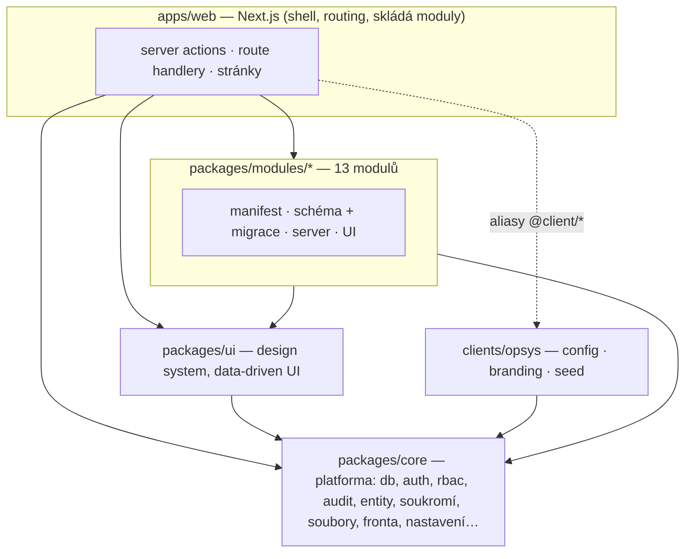
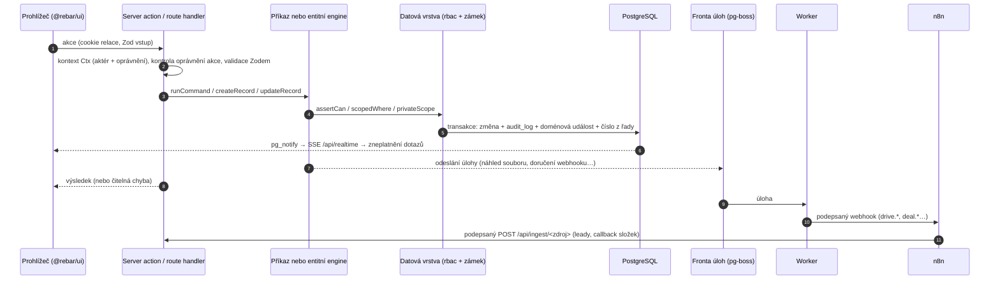
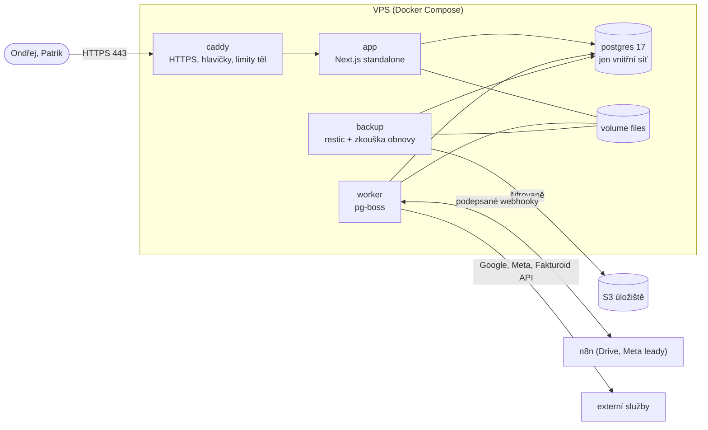

# Architektura

Přehled pro vývojáře a správce. Rozhodnutí a jejich důvody jsou v [ADR](adr/) (OPSYS jako celek: [ADR 028](adr/028-opsys-z-jadra-rebar.md)); tady je
shrnutí, jak kusy zapadají. Provoz popisuje [RUNBOOK](RUNBOOK.md), nasazení [DEPLOYMENT](DEPLOYMENT.md), bezpečnost [SECURITY](SECURITY.md),
zadání a plán OPSYS [docs/opsys/](opsys/00-ZADANI.md).

## 1. Co systém je

**OPSYS** je interní systém agentury OP Digital pro Ondřeje (vlastník) a Patrika (partner): klienti a kontakty, obchody (pipeline), zakázky (web, marketing, systémy),
úkoly a poznámky, kalendář (Google), hodiny, finance (platby, rozdělení mezi společníky, vyrovnání), reklama (Meta), šablony e-mailů, Můj prostor (soukromá sekce
vlastníka) a přehled (nástěnky). Staví se z jádra `rebar` (pracovní název, obor balíčků `@rebar/*`, databáze `rebar_dev`); uživatelům se zobrazuje jen `OPSYS`.

Je to **jedno jádro** a **konfigurace klienta** (`clients/opsys/`): jediná instance pro OP Digital, jeden server, jedna databáze ([ADR 001](adr/001-klientske-instance.md)).
Nová instance pro jiného klienta by vznikla přes `clients/<slug>/` (šablona `clients/_template`), ale OPSYS tak nasazen není.

Stack: Next.js 16 (App Router, Server Components, server actions), TypeScript strict, PostgreSQL 17 + Drizzle ORM, Better Auth (heslo + TOTP, 2FA pro všechny),
Zod, pg-boss (fronta v Postgresu, bez Redisu), Tailwind + Radix, TanStack Table/Query/Virtual, pdfmake, sharp. Správce balíčků je pnpm.

## 2. Monorepo

Moduly v pořadí závislostí (`MODULE_IDS`, v tomto pořadí běží i migrace): `kontakty` · `klienti` (závisí na kontakty) · `disk` · `zakazky` (kontakty) · `obchody` (kontakty, zakázky) · `ukoly` · `kalendar` · `hodiny` (zakázky) ·
`finance` (zakázky) · `reklama` (kontakty, obchody) · `sablony-emailu` (kontakty) · `muj-prostor` (kontakty) · `prehled`.

| Cesta                        | Co v ní je                                                                                                                                                                                                                                                                                                                                                                                  |
| ---------------------------- | ------------------------------------------------------------------------------------------------------------------------------------------------------------------------------------------------------------------------------------------------------------------------------------------------------------------------------------------------------------------------------------------- |
| `packages/core`              | platforma: konfigurace klienta, manifest a registr modulů, **kontrakty mezi moduly** (`contracts/`: služby, události, příspěvky), DB (Drizzle, migrace, práva), auth + 2FA, oprávnění, audit, registr entit a dotazovací engine se zámkem soukromých záznamů, koš, hledání, realtime, historie, webhooky a příchozí požadavky, soubory, fronta, e-mail, nastavení, nástěnky, export, health |
| `packages/ui`                | design system (tokeny, komponenty, app shell, mobilní prvky) a data-driven UI: `EntityList`, `RecordView`, `CreateDialog`, paleta Cmd+K, nástěnky. Nezná Next.js ani server actions                                                                                                                                                                                                         |
| `packages/modules/<id>`      | jeden modul = jeden balíček (viz §3). Moduly neimportují jiné moduly (kromě deklarovaných `dependsOn`)                                                                                                                                                                                                                                                                                      |
| `apps/web`                   | Next.js aplikace: shell, routing, server actions, route handlery (`/api/*`), skládání zapnutých modulů (`modules.ts`, `modules-ui.ts`, `server/modules-server.ts`)                                                                                                                                                                                                                          |
| `clients/opsys`, `_template` | `config.ts`, `branding/`, `seed/` (role, pipeline, vývojová data), `dashboards.ts`                                                                                                                                                                                                                                                                                                          |
| `deploy/`                    | Dockerfile, `docker-compose.yml`, Caddy, PostgreSQL, instalační a zálohovací skripty, šablony n8n flow (`deploy/n8n/`)                                                                                                                                                                                                                                                                      |
| `scripts/`                   | `worker.ts`, `db-migrate.ts`, `db-seed.ts`, `dev-seed.ts`, `config-check.ts`, kontrola čisté instance a výkonu                                                                                                                                                                                                                                                                              |
| `tests/`                     | testy napříč repem: hlídače pravidel, integrační testy modulů proti PostgreSQL, matice soukromí a oprávnění, kontrola nasazení a dokumentace                                                                                                                                                                                                                                                |
| `docs/`                      | dokumentace, `adr/`, `opsys/` (zadání, rozbory, plán, log a otevřené body), `moduly/` (vyprávění), `reference/` (z kódu)                                                                                                                                                                                                                                                                    |

Vrstvy hlídá ESLint (`no-restricted-imports`, `eslint.config.mjs`) a testy ([ADR 006](adr/006-vrstvy-balicku.md)): `core` nezná nic jiného, `ui` zná jen `core`,
moduly znají `core`, `ui` a moduly ze svého `dependsOn`. Jádro nesmí obsahovat podmínku na konkrétního klienta (`tests/guards.test.ts`).

## 3. Modulový systém

Modul je balíček `@rebar/<id>` se čtyřmi vstupy (`package.json` → `exports`):

| Vstup                 | Obsah                                                                                                                                                   | Kdo ho čte                              |
| --------------------- | ------------------------------------------------------------------------------------------------------------------------------------------------------- | --------------------------------------- |
| `.` (`src/index.ts`)  | **manifest** (`defineModule`): `id`, název, ikona, navigace, stránky, **oprávnění** (`<modul>.<akce>`), klíče entit, `dependsOn`, výchozí data (`seed`) | jádro, aplikace, klient i prohlížeč     |
| `./schema`            | tabulky Drizzle (a složka `drizzle/` s SQL migracemi modulu)                                                                                            | server, migrace                         |
| `./server`            | **serverová část** (`defineModuleServer`, v rozdělených modulech složená přes `mergeServers`)                                                           | server a worker, jen u zapnutých modulů |
| `./ui` (`src/ui.tsx`) | **UI část** (`defineModuleUi`, `mergeModuleUi`): záložky a akce na detailu, karty přehledu, stránky, sloty, akce palety                                 | prohlížeč, jen u zapnutých modulů       |

Které moduly běží, určuje `modules` v `clients/opsys/config.ts`. `resolveModules` při startu ověří závislosti a **navigace, katalog oprávnění, entity, příkazy i UI se skládají
jen ze zapnutých modulů**; vypnutý modul v rozhraní nezanechá stopu.

**Co serverová část modulu nabízí** ([ADR 012](adr/012-moduly-prikazy-a-poskytovatele.md), rozšíření v [ADR 028](adr/028-opsys-z-jadra-rebar.md)):

- `entities` — popis entity (`defineEntity`), z něhož vzniká seznam, kanban, filtry, detail, hledání i inline editace ([ADR 010](adr/010-registr-entit-a-ui.md)), včetně zámku soukromých záznamů (`visibility`);
- `commands` — pojmenované příkazy `<modul>.<akce>` (`defineCommand`), jediná cesta, kterou UI volá logiku modulu;
- `services` — **veřejné API mezi moduly** (`ServiceMap` v `packages/core/src/contracts/services.ts`: `clients`, `disk`, `tasks`, `finance`, `emailTemplates`); každá služba má jediného vlastníka (`SERVICE_OWNERS`)
  a volá se jako `deps.services.optional("<klíč>")` — vypnutý modul službu nemá a volající se přizpůsobí;
- `contributions` — příspěvky pro jiné moduly (karta klienta, proměnné e-mailů);
- `eventHandlers` — reakce na **doménové události** (`DomainEventMap` v `contracts/events.ts`: `deal.*`, `client.*`, `project.*`, `task.*`, `payment.*`, `visibility.changed`, `drive.*`); handler běží v transakci emitenta;
- `ingests` — příchozí požadavky z n8n (`defineIngest`, trasa `/api/ingest/<zdroj>`);
- `attention`, `widgets`, `dashboardMetrics`, `calendarLayers`, `navBadges` — poskytovatelé dat pro přehled, nástěnky, kalendář a odznaky v menu;
- `jobs` — úlohy na pozadí (`defineModuleJob`), běží ve workeru; `ensure` — idempotentní doplnění dat při `db:seed`;
- `phaseHooks`, `deleteBlockers` — hooky přechodu fáze zakázky a blokace smazání;
- `privatePaths` — ruční čtecí cesty, které canary test soukromí prochází (`tests/private-paths.int.test.ts`).

Moduly se mezi sebou **nevolají přímo**: spolupráce jde přes služby, příspěvky a události, které skládá aplikace
(`collectServers` v `apps/web/src/server/modules-server.ts`). Odkazy mezi moduly jsou měkké (uuid bez cizího klíče), cizí klíč mají jen závislosti.

**Nástěnky a exporty.** Uživatel si skládá nástěnky z widgetů nad entitami z registru (`aggregateRecords` staví dotaz přes stejnou podmínku jako seznam, takže oprávnění, rozsah řádků
i zámek soukromých záznamů platí i pro součty) a pojmenovanými metrikami modulů. Exporty seznamů jdou jednou cestou (`startExport`), velké přes frontu. Podrobně [DASHBOARDY](DASHBOARDY.md), [EXPORTY](EXPORTY.md).

**Upozornění.** OPSYS žádná nepoužívá (spec je nechce); platforma upozornění zůstává v jádru nevyužitá ([NOTIFICATIONS](NOTIFICATIONS.md)).

## 4. Tok dat a požadavku

1. **UI** je data-driven: stránka seznamu a detailu je jedna trasa `(app)/[...path]`, která adresu přiřadí entitě podle `listPath` (nebo stránce modulu z manifestu). Modul smí mít
   i vlastní statickou trasu (např. `/obchody`, `/zakazky`). UI dostane `EntityApi` (`apps/web/src/lib/entity-api.ts`) a data drží v TanStack Query ([ADR 004](adr/004-klientska-cache-dat.md)).
2. **Server action** vzniká přes `defineAction({ permission, input, handler })` ([ADR 007](adr/007-opravneni-v-datove-vrstve.md)): z cookie se vyrobí kontext (`resolveCtx`),
   zkontroluje se oprávnění a vstup se ověří Zodem. Příkazy modulů vstupují jedním bodem `runCommand`. Mutace mimo server actions kontrolují původ požadavku (`sameOriginOrFail`).
3. **Oprávnění a soukromí se vynucují v datové vrstvě**, ne jen v UI: `assertCan` pro jeden záznam, `scopedWhere` pro seznamy; záznam, který aktér nesmí vidět, se tváří jako neexistující.
   **Soukromé záznamy** (`is_private`) vidí jen vlastník: engine přidává predikát zámku do seznamů, součtů, hledání, exportů, historie, realtime i webhooků; dotazy mimo registr entit musí použít `privateScope(ctx, table)` ([C1](opsys/C1-viditelnost-a-kos.md)).
4. **Transakce + audit:** zápis, číslo z číselné řady a řádek `audit_log` jsou jedna transakce (`inTx`, `recordAudit`) ([ADR 008](adr/008-audit-a-tajemstvi.md)); historie se čte jen přes `auditReadScope`.
5. **Doménové události** (`emitDomain`) se vysílají v transakci změny; handlery modulů běží v ní, odchozí webhooky se doručují z fronty (podpis HMAC, opakování) a smí odejít jen podle oprávnění endpointu ([C2](opsys/D-plan-a-kontrakty.md)).
6. **Realtime** ([C3](opsys/C3-realtime-historie-hledani.md)): `recordAudit` a `emitDomain` volají `pg_notify`; `GET /api/realtime` (SSE) posílá jen typ, id a akci (nikdy data) a klient zneplatní dotazy.
7. **Fronta úloh** ([ADR 009](adr/009-fronta-uloh-a-migrace.md)): doručování webhooků, synchronizace Googlu a Meta, retainery, opakované faktury, úklid koše a souborů, heartbeat běží ve workeru (`pnpm worker`).
8. **Integrace jdou přes n8n** a adaptéry: Google Disk (složky) a Meta leady přes webhooky a `/api/ingest/*`; Google Kalendář, Meta Ads a Fakturoid mají adaptér s rozhraním a fake pro testy.
   Tajemství se ukládají šifrovaně (`APP_ENCRYPTION_KEY`), nikdy do repa.

Další služby jádra: soubory (disk mimo veřejnou složku, kontrola obsahu, stažení jen přes oprávnění), nastavení (`setting`, tajemství AES-256-GCM), komentáře, hledání (`search_document`: bez diakritiky, trigramy, telefony),
koš na 30 dní (`/kos`), historie změn (`/historie`), PDF a health.

## 5. Datový model

Konvence platí pro všechny tabulky jádra i modulů ([ADR 002](adr/002-konvence-datoveho-modelu.md), [ADR 003](adr/003-penize-a-mnozstvi.md)):

- **ID** jsou UUID v7 generované aplikací; **sloupce** `created_at`, `updated_at`, `created_by`, `updated_by`, `deleted_at` (**soft delete**, výchozí dotazy smazané vynechávají);
- **peníze** jsou `bigint` v haléřích (`*_minor`) + měna `CZK`; nikdo není plátce DPH, takže OPSYS DPH nepoužívá (tabulka a správa sazeb zůstaly v jádru, seed je nezakládá);
- **stavy** procesů jsou řádky `pipeline_stage` (název, barva, pořadí, druh `open | won | lost | done`), ne hodnoty v kódu; technické enumy jsou `text` s `CHECK`;
- **číselné řady** (`number_series`): vzor např. `Z-{YYYY}-{NNN}` pro zakázky, číslo se přiděluje v transakci bez děr;
- **vlastní pole**: definice v `custom_field_def`, hodnoty v `custom jsonb` na entitě; **štítky** jsou společný číselník `tag`;
- **soukromí**: tabulky entit se zámkem mají `visibilityColumns()` (`is_private`, zdroj zámku), děti soukromého záznamu zámek dědí;
- **polymorfní vazby** (komentáře, soubory) přes `entity_type` + `entity_id`;
- **názvy** tabulek a sloupců jsou `snake_case` anglicky, texty rozhraní česky.

Skupiny tabulek jádra: identita (`user`, `session`, `account`, `two_factor`, `invitation`, `login_event`, `role`, `role_permission`), audit (`audit_log`), konfigurace
(`setting`, `pipeline`, `pipeline_stage`, `lookup_list`, `lookup_item`, `number_series`, `custom_field_def`), spolupráce (`comment`, `file`, `attachment`),
pohledy a hledání (`saved_view`, `view_favorite`, `search_document`, `recent_record`), integrace (`webhook_endpoint`, `webhook_delivery`, `inbound_event`, `integration_credential`),
provoz (`email_log`, `rate_limit`) a tabulky modulů. Úplný výčet je v [docs/reference/databaze/](reference/databaze/README.md).

### Obchod a zakázka

**Obchod** (`deal`, modul `obchody`) je příležitost v pipeline (fáze s pravděpodobností a lhůtou; výhra a prohra jsou výsledek, ne fáze). Výhra vytvoří klienta a zakázky.
**Zakázka** (`job`, modul `zakazky`) je konkrétní práce pro klienta, typ Web, Marketing nebo Systémy, s fázemi (`job_phase`) ze šablony, týmem, úkoly a platbami; stav zakázky a marketingová etapa
(úvodní fáze, retainer, ukončeno) řídí modul sám a oznamuje `project.*`. Fáze nejsou pevné v kódu (nahradily stavební životní cyklus z ADR 015–016).
Podrobně [docs/moduly/obchody.md](moduly/obchody.md) a [docs/moduly/zakazky.md](moduly/zakazky.md).

## 6. Konfigurace klienta

`clients/opsys/config.ts` (`defineClientConfig`) je typovaná a validovaná Zodem **při startu**: slug, `branding` (`OPSYS`), `locale`, `modules`, `security` (relace 30 dní s prodlužováním,
2FA pro všechny), `navigation`, `dashboards`, `exports`, `notifications` (prázdné). Neplatná konfigurace = aplikace nenastartuje a vypíše všechny chyby. Kontrola bez spuštění: `pnpm config:check`.

Viditelný název systému je **vždy** z konfigurace klienta. Interní pracovní název jádra se nesmí objevit v UI, e-mailech, PDF, URL ani chybách (`tests/guards.test.ts`).

## 7. Nasazení

Jedna instance pro OP Digital: jedna VPS (Docker Compose), jedna databáze. **Image se staví v CI** (`CLIENT=opsys`), na serveru se nikdy nebuilduje ([ADR 014](adr/014-nasazeni-a-provoz.md)).
Jedna image obsahuje aplikaci, worker i nástroje; co se spustí, určuje příkaz v compose.

- **Dva DB uživatelé:** vlastník schématu (`migrator`) spouští migrace a po každé přidělí aplikační roli minimální práva; `app` (aplikace i worker) nemá DDL a do `audit_log` smí jen vkládat a číst.
- **Migrace** jsou jen dopředné a zpětně kompatibilní; moduly mají vlastní složku `drizzle/` a spouštějí se v pořadí `MODULE_IDS`.
- **Zálohy:** denní `pg_dump` + soubory do restic repozitáře (šifrovaně), měsíční zkouška obnovy; výsledek ve `/api/health` a heartbeatu.
- **Provoz:** `/api/health` (za tokenem) a `/api/health/live`, heartbeat, chyby přes `SENTRY_DSN`, Nastavení → Systém (stav, zálohy, fronty, chyby integrací).

Podrobně: [DEPLOYMENT](DEPLOYMENT.md), [RUNBOOK](RUNBOOK.md).

## 8. Seznam rozhodnutí (ADR)

ADR 001–027 jsou **historická** (vznikla pro původní jádro); u každého je v tabulce, co z něj platí pro OPSYS. Rozhodnutí OPSYS: [ADR 028](adr/028-opsys-z-jadra-rebar.md).

| ADR                                                   | Téma                                                                          | Pro OPSYS                                          |
| ----------------------------------------------------- | ----------------------------------------------------------------------------- | -------------------------------------------------- |
| [001](adr/001-klientske-instance.md)                  | image per klient, `CLIENT`, aliasy `@client/*`                                | platí (jedna instance `opsys`)                     |
| [002](adr/002-konvence-datoveho-modelu.md)            | UUID v7, sloupce, soft delete, audit, pipeline, číselné řady                  | platí                                              |
| [003](adr/003-penize-a-mnozstvi.md)                   | peníze v haléřích, množství, zaokrouhlování                                   | platí (bez DPH)                                    |
| [004](adr/004-klientska-cache-dat.md)                 | TanStack Query, optimistické zápisy                                           | platí                                              |
| [005](adr/005-typescript-7-a-eslint.md)               | TypeScript 7 pro `tsc`, 6 pro nástroje                                        | platí                                              |
| [006](adr/006-vrstvy-balicku.md)                      | vrstvy balíčků, nezávislost modulů                                            | platí                                              |
| [007](adr/007-opravneni-v-datove-vrstve.md)           | oprávnění s rozsahem all/own v datové vrstvě                                  | platí; doplňuje zámek soukromých záznamů (ADR 028) |
| [008](adr/008-audit-a-tajemstvi.md)                   | audit v transakci, šifrovaná tajemství                                        | platí                                              |
| [009](adr/009-fronta-uloh-a-migrace.md)               | pg-boss, migrace pod samostatným uživatelem                                   | platí                                              |
| [010](adr/010-registr-entit-a-ui.md)                  | registr entit a data-driven UI                                                | platí                                              |
| [011](adr/011-design-system.md)                       | design system a vzhled                                                        | platí                                              |
| [012](adr/012-moduly-prikazy-a-poskytovatele.md)      | manifest, příkazy, poskytovatelé                                              | platí; služby a události viz ADR 028               |
| [013](adr/013-push-a-pwa.md)                          | PWA, Web Push, fotky z terénu                                                 | PWA ano, push se nepoužívá                         |
| [014](adr/014-nasazeni-a-provoz.md)                   | Docker, Caddy, zálohy, aktualizace                                            | platí                                              |
| [015](adr/015-zakazka-jako-koren.md)                  | zakázka jako kořen systému                                                    | nahrazeno (obchod a zakázka, ADR 028)              |
| [016](adr/016-zivotni-cyklus-faze-prechody.md)        | pevný životní cyklus a fáze zakázky                                           | nahrazeno (`job_phase` ze šablon, ADR 028)         |
| [017](adr/017-fakturace-zadrzne-zalohy-pdp.md)        | fakturace, zádržné, zálohy, přenesená daňová povinnost                        | nepoužívá se (odstraněno)                          |
| [018](adr/018-detail-zakazky-denik-investor.md)       | detail zakázky, stavební deník, odkaz pro investora                           | nepoužívá se (odstraněno)                          |
| [019](adr/019-konfigurace-v-administraci.md)          | konfigurace v administraci: stavy, číselníky, vlastní pole, řady, moduly      | platí (bez DPH)                                    |
| [020](adr/020-exporty-a-odesilani-faktur.md)          | exporty a odesílání faktur                                                    | export platí, faktury se nevystavují               |
| [021](adr/021-kontrola-roli-mobilu-a-pristupnosti.md) | kontrola rolí, mobilu a přístupnosti                                          | platí                                              |
| [022](adr/022-dokumentace-z-kodu.md)                  | dokumentace z kódu a kontrola driftu                                          | platí                                              |
| [023](adr/023-terminal-remeslnika.md)                 | mobilní terminál řemeslníka                                                   | nahrazeno (odstraněno)                             |
| [024](adr/024-katalog-upozorneni.md)                  | katalog událostí upozornění, outbox, předvolby                                | platforma zůstala, OPSYS ji nepoužívá              |
| [025](adr/025-vlastni-nastenky.md)                    | vlastní nástěnky: datový model, dotazy přes entity, bezpečnostní model        | platí                                              |
| [026](adr/026-exporty-fronta-plany.md)                | exporty: fronta, Moje exporty, šablony, plány                                 | platí                                              |
| [027](adr/027-crm-nad-zakazkou.md)                    | CRM nad zakázkou                                                              | nahrazeno (modul `obchody`, ADR 028)               |
| [028](adr/028-opsys-z-jadra-rebar.md)                 | OPSYS z jádra `rebar`: moduly, soukromé záznamy, služby a události, integrace | **platí**                                          |

Dále: [AUDIT](AUDIT.md) (audit dema, z něhož jádro vzniklo; archiv), [OPEN-QUESTIONS](OPEN-QUESTIONS.md), [UI-SPACING](UI-SPACING.md) (systém mezer v UI),
[docs/opsys/F-otevrene-body.md](opsys/F-otevrene-body.md) (co zbývá).
