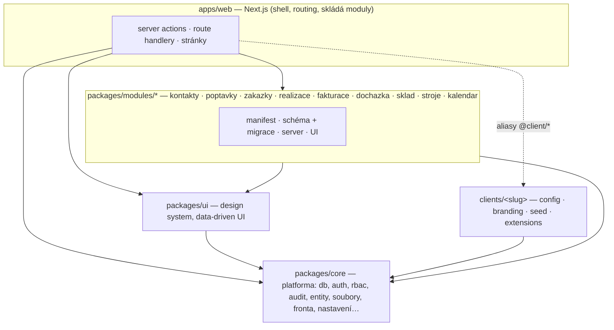
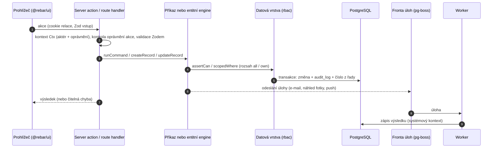
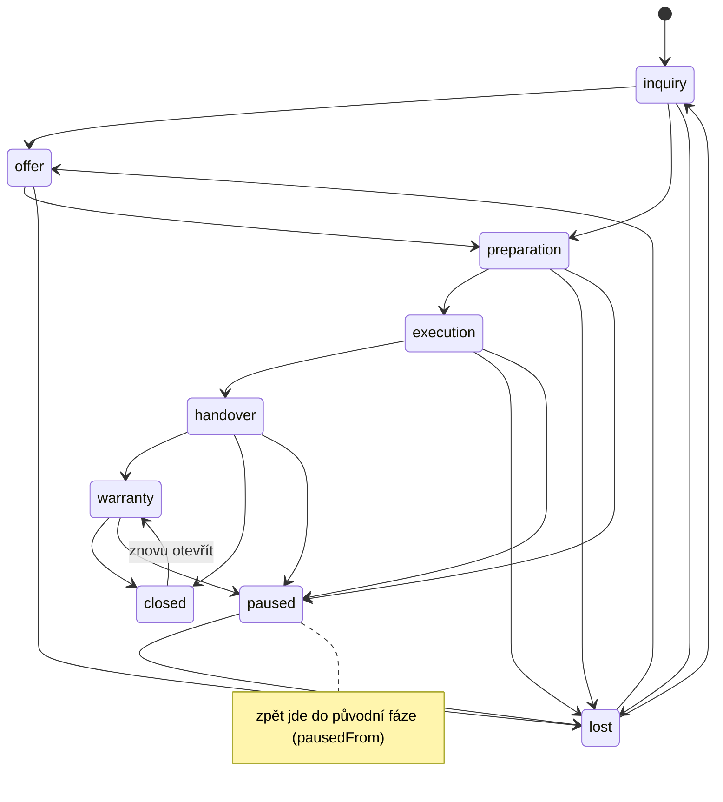
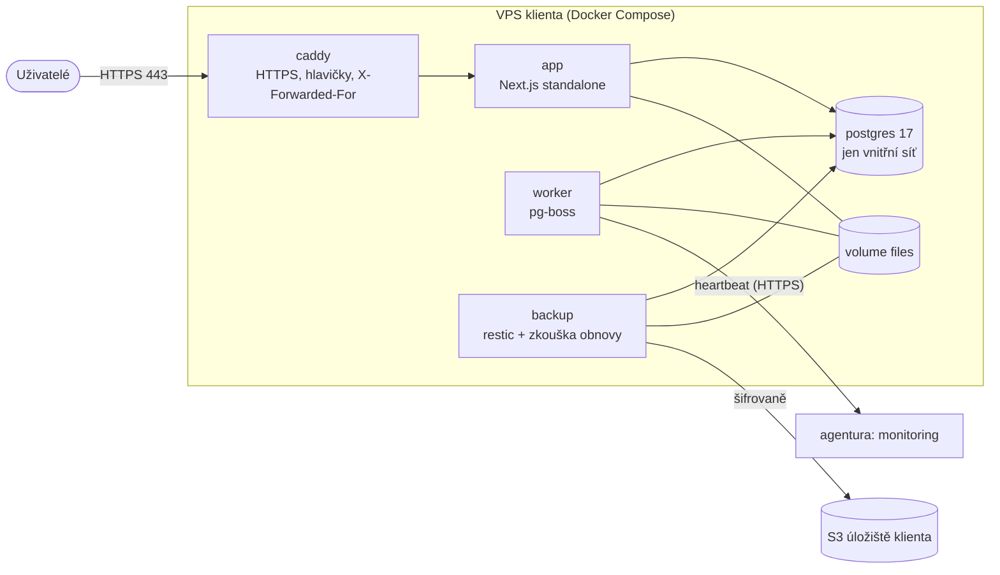

# Architektura

Přehled pro vývojáře a správce agentury a pro technicky zdatného klienta. Rozhodnutí a jejich důvody jsou v [ADR](adr/); tady je
shrnutí, jak kusy zapadají. Úpravy pro klienta popisuje [CUSTOMIZATION](CUSTOMIZATION.md), provoz [RUNBOOK](RUNBOOK.md),
nasazení [DEPLOYMENT](DEPLOYMENT.md), bezpečnost [SECURITY](SECURITY.md).

## 1. Co systém je

Interní firemní systém na míru pro stavební a řemeslné firmy: poptávka → zakázka → realizace → faktura, docházka, sklad, stroje, kalendář.
Je to **jedno jádro** (tento repozitář) a **konfigurace a rozšíření pro každého klienta** (`clients/<slug>/`). Klient nikdy nedostane fork jádra.
Každý klient má vlastní server a vlastní databázi (single-tenant, [ADR 001](adr/001-klientske-instance.md)).

Stack: Next.js 16 (App Router, Server Components, server actions), TypeScript strict, PostgreSQL 17 + Drizzle ORM, Better Auth (heslo + TOTP),
Zod, pg-boss (fronta v Postgresu, bez Redisu), Tailwind + Radix, TanStack Table/Query/Virtual, pdfmake (PDF), sharp (obrázky). Správce balíčků je pnpm.

## 2. Monorepo

| Cesta                            | Co v ní je                                                                                                                                                                                                                  |
| -------------------------------- | --------------------------------------------------------------------------------------------------------------------------------------------------------------------------------------------------------------------------- |
| `packages/core` (`@rebar/core`)  | platforma: konfigurace klienta, manifest a registr modulů, DB (Drizzle, migrace, práva), autentizace + 2FA, oprávnění, audit, registr entit a dotazovací engine, soubory, fronta úloh, e-mail, nastavení, push, health, PDF |
| `packages/ui` (`@rebar/ui`)      | design system (tokeny, komponenty, app shell) a data-driven UI: `EntityList`, `RecordView`, `CreateDialog`. Nezná Next.js ani server actions                                                                                |
| `packages/modules/<id>`          | jeden modul = jeden balíček (viz §3). Moduly neimportují jiné moduly (kromě deklarovaných `dependsOn`)                                                                                                                      |
| `apps/web` (`@rebar/web`)        | Next.js aplikace: shell, routing, server actions, route handlery (`/api/*`), skládání zapnutých modulů; sem se vkompiluje klient přes aliasy `@client/config` a `@client/extensions`                                        |
| `clients/_template`, `clients/*` | šablona a konkrétní klienti: `config.ts`, `branding/`, `seed/`, `extensions/`                                                                                                                                               |
| `deploy/`                        | Dockerfile, `docker-compose.yml`, Caddy, PostgreSQL, instalační a provozní skripty                                                                                                                                          |
| `scripts/`                       | `worker.ts`, `db-migrate.ts`, `db-seed.ts`, `client-new.ts`, `config-check.ts`, `vapid-generate.ts`, hlídání velikosti JS                                                                                                   |
| `tests/`                         | testy napříč repem: hlídače pravidel, integrační testy modulů proti PostgreSQL, kontrola nasazení a dokumentace                                                                                                             |
| `docs/`                          | tato dokumentace, `adr/`, `AUDIT.md` (audit dema), `OPEN-QUESTIONS.md`                                                                                                                                                      |

Vrstvy hlídá ESLint (`no-restricted-imports`, `eslint.config.mjs`) a testy ([ADR 006](adr/006-vrstvy-balicku.md)): `core` nezná nic jiného, `ui` zná jen `core`,
moduly znají `core`, `ui` a moduly ze svého `dependsOn`. Jádro nesmí obsahovat podmínku na konkrétního klienta (`tests/guards.test.ts`).

## 3. Modulový systém

Modul je balíček `@rebar/<id>` se čtyřmi vstupy (`package.json` → `exports`):

| Vstup                 | Obsah                                                                                                                                                                                      | Kdo ho čte                              |
| --------------------- | ------------------------------------------------------------------------------------------------------------------------------------------------------------------------------------------ | --------------------------------------- |
| `.` (`src/index.ts`)  | **manifest** (`defineModule`): `id`, název, ikona, navigace, stránky, **oprávnění** (`<modul>.<akce>`), klíče entit, `dependsOn`, výchozí data (`seed`: pipeline, číselníky, číselné řady) | jádro, aplikace, klient i prohlížeč     |
| `./schema`            | tabulky Drizzle (a složka `drizzle/` s SQL migracemi)                                                                                                                                      | server, migrace                         |
| `./server`            | **serverová část** (`defineModuleServer`): entity, příkazy, poskytovatelé, úlohy na pozadí, hooky přechodů                                                                                 | server a worker, jen u zapnutých modulů |
| `./ui` (`src/ui.tsx`) | **UI část** (`defineModuleUi`): záložky na detailu, akce, karty přehledu, stránky                                                                                                          | prohlížeč, jen u zapnutých modulů       |

Které moduly běží, určuje `modules` v `clients/<slug>/config.ts`. `resolveModules` při startu ověří závislosti (zakázky bez kontaktů nenastartují; `dependsOn` v manifestech) a
**navigace, katalog oprávnění, entity, příkazy i UI se skládají jen ze zapnutých modulů**. Vypnutý modul tedy v rozhraní nezanechá stopu ([ADR 006](adr/006-vrstvy-balicku.md)).
Pořadí `MODULE_IDS` (`packages/core/src/modules/ids.ts`) je pořadí závislostí; v tomto pořadí se spouštějí i migrace.

**Co serverová část modulu nabízí** ([ADR 012](adr/012-moduly-prikazy-a-poskytovatele.md)):

- `entities` — popis entity (`defineEntity`), z něhož vzniká seznam, kanban, filtry, detail, vyhledávání i inline editace ([ADR 010](adr/010-registr-entit-a-ui.md));
- `commands` — pojmenované příkazy `<modul>.<akce>` (`defineCommand`), jediná cesta, kterou UI volá logiku modulu;
- poskytovatelé: `costProviders` (náklady zakázky), `jobInvoicing` (kolik je vyfakturováno), `attention` (Vyžaduje pozornost), `widgets` (dlaždice přehledu),
  `calendarLayers` (vrstvy kalendáře), `diaryPrefill` (předvyplnění stavebního deníku);
- `jobs` — úlohy na pozadí (`defineModuleJob`), běží ve workeru;
- `phaseHooks` — kontroly a automatické akce při přechodu fáze zakázky ([ADR 015](adr/015-zakazka-jako-koren.md), [ADR 016](adr/016-zivotni-cyklus-faze-prechody.md)).

Moduly se mezi sebou **nevolají přímo**: zakázka složí náklady od poskytovatelů, které dodávají sklad, stroje a docházka, a o tom, které z nich jsou zapnuté, rozhoduje aplikace
(`collectServers` v `apps/web/src/server/modules-server.ts`). Odkazy mezi moduly jsou měkké (uuid bez cizího klíče), cizí klíč mají jen závislosti.

**Háčky fází** jsou dvojí a nepleťte je:

- _hooky přechodu fáze_ (`phaseHooks`) — kontroly a automatika uvnitř jádra a modulů, psané v balíčcích modulů;
- _události pro rozšíření klienta_ (`EventMap` v `packages/core/src/extensions/types.ts`) — jediný způsob, jak kód klienta reaguje na dění v jádru (viz [CUSTOMIZATION](CUSTOMIZATION.md)).

### Terminál řemeslníka

Mobilní rozhraní na `/t` (route group `(terminal)`, vlastní rám v `packages/ui/src/terminal/`) pro lidi na stavbě. Moduly do něj přispívají dlaždicemi (`terminalWidgets` v manifestu a v `ModuleUi`),
jádro (`packages/core/src/terminal/`) je skládá podle zapnutých modulů, oprávnění role a konfigurace klienta (`terminal` v `config.ts`, přepsatelné v Nastavení). Zápisy z terminálu jdou
frontou v telefonu a serverem jednou (`terminal_op`, `opId`). Role jen pro terminál nesmí do kancelářského rozhraní (`requireCtx`). Podrobně [TERMINAL](TERMINAL.md), důvody [ADR 023](adr/023-terminal-remeslnika.md).

**Nástěnky a exporty.** Uživatel si skládá nástěnky z widgetů nad entitami z registru (`aggregateRecords` staví dotaz přes stejnou podmínku jako seznam, takže oprávnění a rozsah řádků platí i pro součty) a pojmenovanými metrikami modulů (`dashboardMetrics`). Widgety se načítají souběžně přes `/api/dashboards/evaluate`. Exporty seznamů jdou přes jednu cestu (`startExport`), velké přes frontu a Moje exporty, plánované worker spouští idempotentně. Podrobně [DASHBOARDY](DASHBOARDY.md), [EXPORTY](EXPORTY.md), důvody [ADR 025](adr/025-vlastni-nastenky.md) a [ADR 026](adr/026-exporty-fronta-plany.md).

## 4. Tok dat a požadavku

1. **UI** je data-driven: stránka seznamu a detailu je jedna trasa `(app)/[...path]`, která adresu přiřadí entitě podle `listPath`. UI dostane `EntityApi`
   (`apps/web/src/lib/entity-api.ts`) a data drží v TanStack Query s optimistickými zápisy ([ADR 004](adr/004-klientska-cache-dat.md)).
2. **Server action** vzniká přes `defineAction({ permission, input, handler })` ([ADR 007](adr/007-opravneni-v-datove-vrstve.md)): z cookie se vyrobí kontext (`resolveCtx`),
   zkontroluje se oprávnění a vstup se ověří Zodem. Příkazy modulů vstupují jedním bodem `runCommand` (`apps/web/src/server/module-actions.ts`).
   Mutace mimo server actions (route handlery) kontrolují původ požadavku (`sameOriginOrFail`).
3. **Oprávnění se vynucují v datové vrstvě**, ne jen v UI a ne jen v middleware: `assertCan` pro jeden záznam, `scopedWhere` pro seznamy; záznam, který aktér nesmí vidět,
   se tváří jako neexistující.
4. **Transakce + audit:** zápis, číslo z číselné řady a řádek `audit_log` jsou jedna transakce (`inTx`, `recordAudit`) — změna bez stopy nevznikne ([ADR 008](adr/008-audit-a-tajemstvi.md)).
   Aplikační DB role smí do `audit_log` jen vkládat a číst.
5. **Fronta úloh** ([ADR 009](adr/009-fronta-uloh-a-migrace.md)): e-maily, náhledy fotek, push, úklid souborů, připomínky a heartbeat běží ve workeru (`pnpm worker`, v produkci služba `worker`).
   Web úlohy jen odesílá (`defineJob`, data se validují Zodem při odeslání i zpracování). Worker běží s právy systému (`systemCtx`).
6. **Události pro rozšíření klienta** se oznamují z akce jádra (`emit` v příkazech, `emitEvent` v hoocích entit) a běží v transakci té akce; chyba rozšíření se zachytí a akci nezruší.

Upozornění ([NOTIFICATIONS](NOTIFICATIONS.md)): modul zavolá `notify()` v transakci změny, ta zapíše zvoneček a plán doručení (outbox) a odesílá až worker (push, e-mail). Další služby jádra: soubory (disk mimo veřejnou složku, kontrola obsahu, zmenšení fotek, stažení jen přes oprávnění), nastavení (`setting`, tajemství šifrovaná AES-256-GCM),
komentáře, úkoly a upozornění (polymorfní vazba `entity_type` + `entity_id`), Web Push, hledání (`search_document`: bez diakritiky, trigramy), PDF a health.

## 5. Datový model

Konvence platí pro všechny tabulky jádra i modulů ([ADR 002](adr/002-konvence-datoveho-modelu.md), [ADR 003](adr/003-penize-a-mnozstvi.md)):

- **ID** jsou UUID v7 generované aplikací; **sloupce** `created_at`, `updated_at`, `created_by`, `updated_by`, `deleted_at` (**soft delete**, výchozí dotazy smazané vynechávají);
- **peníze** jsou `bigint` v haléřích + kód měny, sloupce `*_minor`; sazby DPH v setinách procenta (`rate_bp`, 21 % = 2100); množství `numeric(14,3)`;
  zdokumentovaná výjimka je jednotková cena skladové položky `numeric(14,4)` (vážený průměr);
- **stavy** procesů jsou řádky `pipeline_stage` (název, barva, pořadí, druh `open | won | lost | done`), ne hodnoty v kódu; technické enumy jsou `text` s `CHECK`;
- **číselné řady** (`number_series`): vzor např. `FV-{YYYY}-{NNNN}`, číslo se přiděluje v transakci jedním `UPDATE … RETURNING`, bez děr;
  výchozí řady dodávají moduly (`Z-{YYYY}-{NNN}` zakázky, `FV-{YYYY}-{NNNN}` faktury, `PR-/VY-/PV-…` sklad), vzor jde změnit v administraci;
- **vlastní pole**: definice v `custom_field_def`, hodnoty v `custom jsonb` na entitě (GIN index), fungují v tabulce, filtrech, řazení, detailu i hledání;
- **polymorfní vazby** (komentáře, úkoly, soubory) přes `entity_type` + `entity_id`;
- **názvy** tabulek a sloupců jsou `snake_case` anglicky, texty rozhraní česky.

Skupiny tabulek: identita (`user`, `session`, `account`, `two_factor`, `invitation`, `login_event`, `role`, `role_permission`), audit (`audit_log`), konfigurace
(`setting`, `pipeline`, `pipeline_stage`, `lookup_list`, `lookup_item`, `number_series`, `vat_rate`, `custom_field_def`), spolupráce (`comment`, `task`, `notification`, `file`, `attachment`),
pohledy a hledání (`saved_view`, `search_document`), provoz (`email_log`, `rate_limit`, `push_subscription`) a tabulky modulů ve schématu daného balíčku.

### Pipeline a fáze zakázky

Zakázka je kořen systému ([ADR 015](adr/015-zakazka-jako-koren.md), [ADR 016](adr/016-zivotni-cyklus-faze-prechody.md)). **Fáze jsou pevné v kódu**, **stavy uvnitř fáze konfiguruje klient** v pipeline `job/default`
(stav patří do fáze přes `pipeline_stage.phase`). `job.phase` je odvozený sloupec; mění se jen přechodem, který spustí hooky.

Diagram ukazuje povolené přechody dopředu a do vedlejších fází; kromě nich je povolen i krok zpět o jednu fázi jako oprava (např. realizace → příprava). Úplná tabulka je `NEXT` v `packages/modules/zakazky/src/lifecycle/phases.ts` (`allowedNext`, `transitionProblem`).
Dopady přechodu (zamčení nabídky a kopie do realizace, otevření deníku, předávací protokol) řeší hooky modulů, které je znají.

## 6. Konfigurace klienta

`clients/<slug>/config.ts` (`defineClientConfig`) je typovaná a validovaná Zodem **při startu**: slug, `branding` (název systému, zkratka, akcentová barva, logo, e-mail podpory),
`locale`, `modules`, `security` (odhlášení po neaktivitě, role s povinným 2FA), `agency` (servisní přístup agentury). Neplatná konfigurace = aplikace nenastartuje a vypíše všechny chyby
(`apps/web/src/instrumentation-node.ts`). Kontrola bez spuštění: `pnpm config:check`.

Viditelný název systému je **vždy** z konfigurace klienta (nebo z nastavení Vzhled v administraci, které má přednost). Interní pracovní název jádra se nesmí objevit v UI, e-mailech, PDF,
URL ani chybách; hlídá to `tests/guards.test.ts` a validace názvu v konfiguraci.

Klientské rozšíření (`clients/<slug>/extensions/`) se k jádru připojuje jen přes veřejné události ([CUSTOMIZATION](CUSTOMIZATION.md)).

## 7. Nasazení

Jeden klient = jedna VPS (1 vCPU / 4 GB, Ubuntu 24.04) = jedna databáze. **Image se staví v CI pro každého klienta zvlášť** (`CLIENT=<slug>` při buildu vkompiluje konfiguraci a rozšíření;
[ADR 001](adr/001-klientske-instance.md)), na serveru se nikdy nebuilduje ([ADR 014](adr/014-nasazeni-a-provoz.md)). Jedna image obsahuje aplikaci i worker i nástroje; co se spustí, určuje příkaz v compose.

- **Dva DB uživatelé:** vlastník schématu (`migrator`) spouští migrace a po každé přidělí aplikační roli minimální práva; `app` (aplikace i worker) nemá DDL a do `audit_log` smí jen vkládat a číst.
- **Migrace** jsou jen dopředné a zpětně kompatibilní (expand → contract); kód migrací není součástí běžící aplikace.
- **Zálohy:** denní `pg_dump` + soubory do restic repozitáře (šifrovaně), měsíční zkouška obnovy do dočasné databáze; výsledek ve `/api/health` a heartbeatu.
- **Provoz:** `/api/health` (za tokenem) a `/api/health/live`, hodinový heartbeat, chyby přes `SENTRY_DSN` se scrubbingem osobních údajů, metriky serveru Beszel.

Podrobně: [DEPLOYMENT](DEPLOYMENT.md), [RUNBOOK](RUNBOOK.md).

## 8. Seznam rozhodnutí (ADR)

| ADR                                              | Téma                                                                          |
| ------------------------------------------------ | ----------------------------------------------------------------------------- |
| [001](adr/001-klientske-instance.md)             | image per klient, `CLIENT`, aliasy `@client/*`                                |
| [002](adr/002-konvence-datoveho-modelu.md)       | UUID v7, sloupce, soft delete, audit, pipeline, číselné řady                  |
| [003](adr/003-penize-a-mnozstvi.md)              | peníze v haléřích, množství, zaokrouhlování                                   |
| [004](adr/004-klientska-cache-dat.md)            | TanStack Query, optimistické zápisy                                           |
| [005](adr/005-typescript-7-a-eslint.md)          | TypeScript 7 pro `tsc`, 6 pro nástroje                                        |
| [006](adr/006-vrstvy-balicku.md)                 | vrstvy balíčků, nezávislost modulů                                            |
| [007](adr/007-opravneni-v-datove-vrstve.md)      | oprávnění s rozsahem all/own v datové vrstvě                                  |
| [008](adr/008-audit-a-tajemstvi.md)              | audit v transakci, šifrovaná tajemství                                        |
| [009](adr/009-fronta-uloh-a-migrace.md)          | pg-boss, migrace pod samostatným uživatelem                                   |
| [010](adr/010-registr-entit-a-ui.md)             | registr entit a data-driven UI                                                |
| [011](adr/011-design-system.md)                  | design system a vzhled                                                        |
| [012](adr/012-moduly-prikazy-a-poskytovatele.md) | manifest, příkazy, poskytovatelé                                              |
| [013](adr/013-push-a-pwa.md)                     | PWA, Web Push, fotky z terénu                                                 |
| [014](adr/014-nasazeni-a-provoz.md)              | Docker, Caddy, zálohy, aktualizace                                            |
| [015](adr/015-zakazka-jako-koren.md)             | zakázka jako kořen systému                                                    |
| [016](adr/016-zivotni-cyklus-faze-prechody.md)   | životní cyklus, fáze a přechody                                               |
| [017](adr/017-fakturace-zadrzne-zalohy-pdp.md)   | fakturace, zádržné, zálohy, přenesená daňová povinnost                        |
| [018](adr/018-detail-zakazky-denik-investor.md)  | detail zakázky, stavební deník, odkaz pro investora                           |
| [019](adr/019-konfigurace-v-administraci.md)     | konfigurace v administraci: stavy, číselníky, vlastní pole, řady, DPH, moduly |
| [024](adr/024-katalog-upozorneni.md)             | katalog událostí upozornění, outbox, spolehlivé doručování, předvolby         |
| [023](adr/023-terminal-remeslnika.md)            | mobilní terminál řemeslníka: dlaždice, role, fronta zápisů, offline           |
| [025](adr/025-vlastni-nastenky.md)               | vlastní nástěnky: datový model, dotazy přes entity, bezpečnostní model        |
| [026](adr/026-exporty-fronta-plany.md)           | exporty: fronta, Moje exporty, šablony, plány, účetní formáty                 |

Dále: [AUDIT](AUDIT.md) (audit dema, z něhož jádro vzniklo), [OPEN-QUESTIONS](OPEN-QUESTIONS.md), [ZAKAZKA](ZAKAZKA.md) (pracovní smlouva oblastí modulu Zakázky), [UI-SPACING](UI-SPACING.md) (systém mezer v UI).
