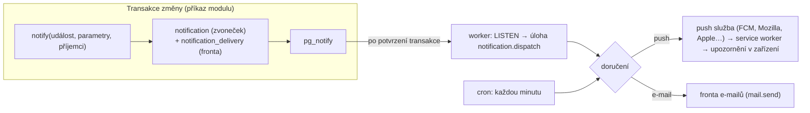

# Upozornění: push, zvoneček a e-mail

> **OPSYS tuto platformu nepoužívá.** Spec výslovně žádné notifikace nechce (upozornění jsou jen vizuální: odznaky u položek menu, červené řádky). Moduly OPSYS neregistrují žádné události upozornění, katalog jádra obsahuje jen `comment.mention` (zmínka v komentáři), kterou `clients/opsys/config.ts` vypíná (`enabled: false`), a interní `system.test`. Platformní kód (fronta doručení, push, zvoneček, e-mail, předvolby) zůstává v jádru beze změny pro případ, že by se upozornění později zapnula; text níže popisuje platformu a příklady jsou obecné.

Jak systém upozorňuje lidi na to, co se děje: **co** se hlásí (katalog událostí), **komu** (příjemci podle pravidel firmy a oprávnění), **kudy** (push do telefonu, zvoneček v aplikaci, e-mail),
**kdy** (ihned, ve shrnutí, mimo tiché hodiny) a **jak je zaručeno, že to dorazí právě jednou**. Rozhodnutí a jejich důvody: [ADR 024](adr/024-katalog-upozorneni.md); původní základ (PWA, Web Push, VAPID): [ADR 013](adr/013-push-a-pwa.md).

## Obsah

1. [Přehled](#1-přehled)
2. [Katalog událostí](#2-katalog-událostí)
3. [Jak přidat událost z modulu](#3-jak-přidat-událost-z-modulu)
4. [Pravidla firmy: konfigurace klienta a Nastavení](#4-pravidla-firmy-konfigurace-klienta-a-nastavení)
5. [Předvolby uživatele](#5-předvolby-uživatele)
6. [Doručování](#6-doručování)
7. [Plánované události](#7-plánované-události)
8. [Bezpečnost a soukromí](#8-bezpečnost-a-soukromí)
9. [Zařízení a prohlížeče: iOS, Android, počítač](#9-zařízení-a-prohlížeče-ios-android-počítač)
10. [Nasazení: klíče VAPID a worker](#10-nasazení-klíče-vapid-a-worker)
11. [Push nechodí: postup krok za krokem](#11-push-nechodí-postup-krok-za-krokem)
12. [Testy a co se nedá ověřit automaticky](#12-testy-a-co-se-nedá-ověřit-automaticky)

## 1. Přehled



- **Jedna cesta pro všechno.** Modul nikdy neposílá nic sám: zavolá `notify()` uvnitř transakce, která změnu provádí. `notify` jen zapíše řádky (zvoneček a plán doručení). Selže-li transakce, nevznikne nic (**outbox**);
  push služba ani SMTP se při změně nevolají, takže pomalá nebo nedostupná služba nikdy nezdrží ani neshodí akci uživatele.
- **Worker odesílá.** Po potvrzení transakce databáze pošle `NOTIFY`, worker se po 1,5 s (sloučení) probudí a zařadí úlohu `notification.dispatch` do fronty pg-boss. Úloha běží i každou minutu jako záloha
  (restart, výpadek spojení) a uvolňuje zdržená doručení (tiché hodiny, shrnutí, opakování).
- **Tři kanály:** `push` (do zařízení), `bell` (zvoneček = Inbox v aplikaci, počet nepřečtených u položky Inbox a odznak na ikoně), `e-mail`.
- **Složení pravidel** (od nejobecnějšího): definice události v katalogu → `notifications` v `clients/<klient>/config.ts` → úpravy správce v Nastavení → Pravidla upozornění → předvolby uživatele v Nastavení → Upozornění.
- **Obsah se skládá pro každého příjemce zvlášť** podle jeho oprávnění: kdo nemá právo na záznam, upozornění nedostane; kdo nesmí vidět peníze, dostane text bez částek.

## 2. Katalog událostí

Událost je datový popis (`defineNotificationEvent`): klíč, český název a popis, skupina v nastavení, závažnost (`normal` / `urgent`), výchozí kanály, skupiny příjemců (`audiences`) a výchozí příjemci (`recipients`),
parametry textu (`params`), šablona (`title`, `body`, `url`), typ záznamu (`entity`) a doplňky (`dedupe`, `mergeWindowSeconds`, `debounceSeconds`, `ttlSeconds`, `mandatory`, `snooze`, `scheduled`).
Události platformy (komentáře) jsou v `packages/core/src/notifications/catalog.ts`; události modulů jsou v manifestu modulu (`notifications` v `src/index.ts`, definice v `src/notifications.ts`), jádro je nezná.
Katalog zapnutých modulů se skládá při startu (`collectNotificationEvents`) a **ověřuje**: neplatný klíč, neznámý parametr v šabloně nebo příjemce mimo skupiny aplikaci nenastartuje.

Úplný seznam podle skutečného kódu je v Nastavení → Pravidla upozornění; přehled ke dni zápisu (hlídá ho test `tests/notifications-docs.test.ts`, po přidání události ho aktualizuj):

<!-- katalog:start -->

| Klíč              | Název              | Komu (výchozí)    | Kudy           | Příznaky |
| ----------------- | ------------------ | ----------------- | -------------- | -------- |
| `comment.mention` | Zmínka v komentáři | Označený uživatel | push, zvoneček |          |

<!-- katalog:end -->

Sloupec „Komu“ jsou **výchozí** příjemci: skupiny, které dodá kód události (např. tým zakázky), nebo `perm:<oprávnění>` (všichni s oprávněním) a `role:<klíč role>`. Správce klienta je mění (§4).
Příznaky: _naléhavé_ prorazí tiché hodiny a shrnutí a má u push služby vysokou prioritu; _plánované_ vznikají z úlohy (§7); _povinné_ uživatel nevypne; _odložit_ nabídne na push akci „Odložit o hodinu“; _slučuje_ spojí bouřku změn do jednoho upozornění.

## 3. Jak přidat událost z modulu

1. **Definice** v `packages/modules/<modul>/src/notifications.ts` (čistá data, importuje se jen z `@rebar/core/manifest`, takže manifest zůstane lehký pro prohlížeč):

   ```ts
   import { defineNotificationEvent } from "@rebar/core/manifest";

   export const DEFECT_ASSIGNED = defineNotificationEvent({
     key: "defect.assigned", // <skupina>.<událost>, malá písmena; stabilní, na klíč se odkazuje konfigurace a předvolby
     label: "Přidělena vada", // název v nastavení
     description: "Někdo vám přidělil vadu k vyřešení.", // kdy a komu to přijde
     group: "Realizace",
     severity: "normal", // "urgent" prosadí tiché hodiny
     channels: { push: true, bell: true, email: false }, // výchozí kanály
     audiences: { assignee: "Odpovědný za vadu" }, // skupiny, které dodá volající
     recipients: ["assignee"], // výchozí příjemci (skupina, perm:<oprávnění>, role:<klíč>)
     params: {
       title: { label: "Název vady", example: "Praskliná omítka" },
       cost: { label: "Odhad nákladů", example: "12 000 Kč", sensitive: "money" }, // jen pro ty, kdo smí vidět peníze
     },
     template: {
       title: "Máte řešit vadu: {title}",
       body: "Odhad: {cost}", // řádek s chybějícím nebo nedostupným parametrem se vynechá
       url: "/realizace/vady/{entityId}", // odkaz na konkrétní záznam, záložku nebo stránku terminálu
     },
     entity: "defect", // typ záznamu: kdo ho nesmí číst, upozornění nedostane
     dedupe: "record", // jednou pro záznam a příjemce
   });
   ```

2. **Registrace** v manifestu modulu: `notifications: [DEFECT_ASSIGNED, …]` v `defineModule({...})`.
3. **Vyvolání** v serverové části, uvnitř transakce změny (`c.db`):

   ```ts
   import { notify } from "@rebar/core/notifications";

   await notify(c.db, DEFECT_ASSIGNED, {
     params: { title: row.title, cost: formatMinor(row.costMinor) }, // hotové texty; datum a peníze formátuje volající
     to: { assignee: [row.responsibleId] }, // skupiny z `audiences`
     record: { type: "defect", id: row.id }, // podle záznamu se ověřuje přístup a skládá odkaz
     actorId: c.actor.userId, // tomu, kdo změnu udělal, se upozornění neposílá
   });
   ```

4. **Plánovaná událost:** úloha modulu (`defineModuleJob` s `cron`, čas v Europe/Prague) volá `notify` s `at: now` a `dedupe: "day"` (nebo vlastním tokenem), aby opakované spuštění nic nezdvojilo (§7).
5. **Test:** `validateEventDefs([...])` v testu modulu (klíč, parametry, příjemci), integrační test příjemců, obsahu podle oprávnění a odkazu. Vzory: `packages/core/src/notifications/notifications.int.test.ts`.
6. Doplň řádek do tabulky v §2 (test `tests/notifications-docs.test.ts` hlídá, že tabulka odpovídá katalogu).

Pravidla psaní šablon: parametry jsou hotové řetězce; peníze vždy `sensitive: "money"` a v titulku za oddělovač (`: `, `·`, `—`, `, `, ` (`), aby šly vynechat i s ním; v podtitulku každý údaj raději na vlastní řádek. `{entityId}` (id záznamu) a `{count}` jsou k dispozici vždy.
Odkaz musí začínat `/`; parametry se do něj vkládají zakódované. **Nikdy** nevolej `createNotifications` (starý způsob, ponechán v jádru jen pro zpětnou kompatibilitu; guard test ho v modulech zakazuje) ani přímo push.

## 4. Pravidla firmy: konfigurace klienta a Nastavení

**Výchozí v kódu klienta** (`clients/<klient>/config.ts`, validace zodem při startu, `pnpm config:check`):

```ts
notifications: {
  quietHours: { enabled: true, start: "20:00", end: "06:00" }, // tiché hodiny (push se zdrží, naléhavé projdou)
  digestTimes: ["07:00", "16:00"], // kdy chodí shrnutí
  events: {
    "approval.request": { mandatory: true }, // nejde vypnout
    "comment.mention": { channels: { email: false } },
    "invoice.overdue": { recipients: ["perm:fakturace.write", "role:owner"], severity: "urgent" },
    "comment.mention": { title: "{author} vás zmínil", body: "{excerpt}" }, // vlastní text
  },
},
```

Položky události: `enabled`, `mandatory`, `severity`, `channels` (`push`, `bell`, `email`), `recipients`, `title`, `body` (prázdný řetězec podtitulek vypne). Neznámý klíč události, příjemce mimo skupiny události (`audiences`, `perm:`, `role:`)
nebo neznámý parametr v textu je **chyba při startu** i v `pnpm config:check`.

**Úpravy správce** (Nastavení → Pravidla upozornění, oprávnění `settings.manage`) mají přednost před konfigurací v souboru a platí hned pro nová upozornění. Správce:

- zapne nebo vypne událost (vypnutá se nikomu nedoručí, ani do zvonku),
- označí událost jako **povinnou** (uživatel ji nemůže vypnout a nemůže ji přesunout do shrnutí),
- změní **závažnost**, **výchozí kanály** a **příjemce** (skupina události, role, oprávnění),
- přepíše **text** (titulek, podtitulek) s živým náhledem a vložením parametrů; „Vrátit výchozí text“ a „Zrušit všechny úpravy této události“,
- nastaví výchozí **tiché hodiny** a **časy shrnutí** firmy,
- vidí **doručování za 24 hodin** (počty podle stavu, důvody přeskočení, poslední selhání bez obsahu zpráv).

Uloženo v nastavení `notification_rules` (audit změn jako u jiných nastavení). Příjemce nikdy nedostane upozornění o záznamu, který nesmí číst, ať je v pravidlech cokoli.
Důsledek: příjemce z `perm:` bez práva číst zakázku (např. uživatel bez `zakazky.read`) upozornění o záznamu nedostane; dejte mu právo, nebo událost nastavte na jiné příjemce.

## 5. Předvolby uživatele

Nastavení → Upozornění (každý přihlášený, i v terminálu řemeslníka):

- u každé události, která se ho týká (podle oprávnění): **do telefonu** `Ihned` / `Shrnutí` / `Ne`, **zvoneček** a **e-mail** zapnout/vypnout; povinné a naléhavé události se nevypínají;
- **tiché hodiny** (výchozí z firmy, vlastní okno jde nastavit nebo vypnout): zvoneček a e-mail jdou hned, push se zdrží do konce tichých hodin a pošle se jako jedna zpráva; **naléhavé** projdou;
- **shrnutí**: časy (až dva), kdy chodí jedna zpráva s přehledem místo mnoha jednotlivých;
- **zařízení**: stav tohoto zařízení (zapnuto / vypnuto / zablokováno v prohlížeči / nepodporováno / iPhone potřebuje „Přidat na plochu“) s českým návodem, tlačítko **Pošli mi zkušební upozornění**
  (jde stejnou frontou jako ostatní a stránka ukáže výsledek: odesláno, přeskočeno s důvodem, čeká ve frontě), seznam zařízení s odhlášením jednoho zařízení;
- **poslední doručení**: co se s posledními upozorněními stalo a proč (např. „přeskočeno: vypnuto v předvolbách“).

V databázi se ukládají jen odchylky od výchozích hodnot, takže pozdější změna výchozího chování firmy se projeví i těm, kdo nic neměnili.

## 6. Doručování

| Vlastnost               | Jak                                                                                                                                                                                                                                                                           |
| ----------------------- | ----------------------------------------------------------------------------------------------------------------------------------------------------------------------------------------------------------------------------------------------------------------------------- |
| Odeslání mimo požadavek | Výhradně worker (úloha `notification.dispatch`, pg-boss). Web ani moduly nesahají na push službu ani SMTP (guard test).                                                                                                                                                       |
| Outbox                  | `notification` a `notification_delivery` vznikají v transakci změny; `pg_notify` se doručí až po jejím potvrzení. Zrušená transakce nezanechá nic.                                                                                                                            |
| Idempotence             | `dedupe: "record"` / `"day"` (+ token): unikátní index `(user_id, dedupe_key)`; druhé vyvolání téže události pro téhož příjemce nic nevytvoří. Odeslání si řádek „zabere“ (`FOR UPDATE SKIP LOCKED`), souběžné běhy nepošlou totéž dvakrát.                                   |
| Opakování s prodlevou   | Přechodná chyba (429, 5xx, výpadek): zkusí se znovu po 30 s, 2 min, 10 min, 30 min, 2 h, 6 h; pak stav `failed`. Trvalé odmítnutí (400, 401, 403, 413) se neopakuje (`push_rejected`, obvykle špatné klíče VAPID).                                                            |
| Mrtvé odběry            | 404 a 410 od push služby smaže odběr; nezbývá-li zařízení, doručení je `skipped` s důvodem `no_device`. Odběr s chybami drží počítadlo a poslední chybu (zobrazí se u zařízení).                                                                                              |
| Sloučení bouřky         | Nepřečtené upozornění téže události a záznamu se po dobu `mergeWindowSeconds` aktualizuje („Změna harmonogramu (20×)“) a push se zdrží o `debounceSeconds`, takže odejde jedna zpráva. Stejné `tag` nahradí starší upozornění v zařízení.                                     |
| Shrnutí a zahlcení      | Víc než 3 běžná upozornění najednou, nebo víc zdržených po tichých hodinách či shrnutí, odejde jako jedna zpráva „N nových upozornění“. Nad 20 push za 10 minut na člověka se běžná upozornění odloží o 10 minut.                                                             |
| TTL a urgency           | Běžné: TTL 24 h, urgency `normal`; naléhavé: TTL 6 h, urgency `high`, požaduje reakci; událost může mít vlastní `ttlSeconds` (např. připomínka kalendáře 10 min). Stará upozornění (od plánovaného odeslání) se neposílají. Téma (`Topic`) nahradí nedoručenou starší zprávu. |
| Přečtené se neposílá    | Upozornění přečtené před odesláním se přeskočí (`already_read`).                                                                                                                                                                                                              |
| Odznak a zavírání       | Zpráva nese počet nepřečtených (odznak na ikoně nainstalované aplikace). Klepnutí na push označí upozornění za přečtené; přečtení v Inboxu zavře odpovídající push v zařízení (podle `tag`).                                                                                  |
| Odložit                 | Akce na push u událostí s `snooze`: připomene se za hodinu (`/api/push/snooze`, jen majitel upozornění).                                                                                                                                                                      |
| Protokol                | `notification_delivery`: stav (`queued`, `held`, `retry`, `sending`, `sent`, `failed`, `skipped`), důvod, počet pokusů, počet zařízení a hostitelé push služeb. **Nikdy** adresy odběrů, klíče ani obsah zpráv. Uživatel vidí svá doručení, správce souhrn.                   |
| Úklid                   | Denně 03:20: upozornění starší než 90 dní a skrytá (jen push, zkušební) starší než 7 dní se mažou i s protokolem.                                                                                                                                                             |

Stavy a důvody přeskočení: `user_off` (vypnuto uživatelem), `event_off` (kanál u události vypnutý), `no_device`, `already_read`, `expired`, `merged`, `user_inactive`, `push_not_configured`, `email_not_configured`, `rate_limited`, `summary`/`summarized`, `push_rejected`, `retries_exhausted`, `snoozed`.

## 7. Plánované události

Platforma umí plánované události (úloha modulu s `cron`, `notify` s `dedupe`), ale **OPSYS žádnou neregistruje**: úloha `notification.taskDigest` i `kalendar.reminders` zanikly spolu s událostmi `task.*` a `kalendar.*`. Úlohy OPSYS (Disk, Google Kalendář, retainer, Meta, opakované faktury, úklid koše a webhooků) jsou v `reference/udalosti-a-ulohy.md`.

Plánované události jsou **idempotentní** (`dedupe` pro příjemce a den nebo token fáze) a **časové pásmo a změna času** řeší dvě vrstvy: cron běží v Europe/Prague (pg-boss),
„dnes“ a hranice dne se počítají místním datem (`localParts`, `zonedToUtc`), takže v den změny času (poslední neděle v březnu a v říjnu) nic nevypadne ani se nezdvojí. Konec tichých hodin a časy shrnutí
se počítají do místního času (nejednoznačná hodina = první výskyt, neexistující se posune dopředu); pokrývá je test `packages/core/src/notifications/notifications.test.ts`.

## 8. Bezpečnost a soukromí

- **Obsah push nesmí prozradit citlivá data.** Zpráva se skládá pro konkrétního příjemce podle jeho oprávnění: parametry označené `sensitive` (peníze, případně vlastní oprávnění) se do textu nedostanou (řádek nebo klauzule se vynechá),
  navíc pojistka odstraní z textu cokoli, co vypadá jako částka, komu nepatří peníze (`MONEY_PERMISSIONS`). Test: `notifications.int.test.ts` (mistr nevidí částku ani v push zprávě).
- **Příjemce bez práva na záznam upozornění nedostane** (politika přístupu typu záznamu, rozsah `own` = jen vlastník; neexistující záznam = nikdo).
- **Odběr patří přihlášenému:** uložení, výpis i smazání jen vlastních odběrů (cizí `endpoint` ani id zařízení nejde smazat, test), zařízení převzaté jiným uživatelem změní majitele odběru. Odběr se váže na relaci:
  odhlášení zruší odběry zařízení, **deaktivace účtu** a „odhlásit ze všech zařízení“ zruší všechny odběry uživatele.
- **Adresa odběru** musí být https a patřit známé push službě (FCM, Mozilla, Apple, Windows), jinak by šlo server donutit volat libovolnou adresu (SSRF). Odkaz v upozornění je vždy cesta v aplikaci.
- **Klíče VAPID jen z prostředí** (`VAPID_PUBLIC_KEY`, `VAPID_PRIVATE_KEY`, `VAPID_SUBJECT`); do databáze, logu ani protokolu doručení se nedostanou. Veřejný klíč smí do prohlížeče.
- **Rozhraní** `/api/push/*` kontrolují přihlášení a původ požadavku; `opened` a `snooze` přijímají jen id vlastního upozornění.

## 9. Zařízení a prohlížeče: iOS, Android, počítač

| Platforma                                   | Podpora a omezení                                                                                                                                                                                                                                                                   |
| ------------------------------------------- | ----------------------------------------------------------------------------------------------------------------------------------------------------------------------------------------------------------------------------------------------------------------------------------- |
| **iPhone, iPad (iOS 16.4+)**                | Push **jen u aplikace přidané na plochu** (Safari → Sdílet → Přidat na plochu → otevřít z plochy → Zapnout). V obyčejné kartě Safari push nejde. Odznak na ikoně funguje u nainstalované aplikace. Bez iOS 16.4 push nejde vůbec. Systém může upozornění v úsporném režimu zpozdit. |
| **Android (Chrome, Edge)**                  | Funguje v prohlížeči i po „Přidat na plochu“. Zablokováno v prohlížeči: zámek vlevo od adresy → Oprávnění → Oznámení → Povolit; zkontrolovat i Nastavení telefonu → Aplikace → Chrome → Oznámení. Úsporný režim baterie a „optimalizace“ mohou doručení zdržet.                     |
| **Počítač (Chrome, Edge, Firefox, Safari)** | Funguje, když je prohlížeč spuštěný (nebo služba na pozadí). Zablokováno: ikona zámku vlevo od adresy → Oznámení → Povolit.                                                                                                                                                         |
| **Soukromé okno, vypnuté cookies**          | Odběr se neuloží nebo zmizí po zavření okna.                                                                                                                                                                                                                                        |

Stránka Upozornění v telefonu rozpozná stav a ukáže správný návod; při přechodu na nový telefon se zařízení zapne znovu (odběr patří zařízení, ne uživateli).
Po rotaci odběru prohlížečem (`pushsubscriptionchange`) se service worker přihlásí znovu a starý odběr nahradí novým.

## 10. Nasazení: klíče VAPID a worker

1. `pnpm vapid:generate` vypíše `VAPID_PUBLIC_KEY`, `VAPID_PRIVATE_KEY`, `VAPID_SUBJECT` (`mailto:` správce nebo adresa https). Instalační skript (`deploy/scripts/install.sh`) je generuje při instalaci.
2. Hodnoty patří do `.env` serveru (ne do repozitáře). Bez nich se push nenabízí a doručení jsou `skipped / push_not_configured`; zvoneček a e-mail fungují.
3. **Worker musí běžet** (`pnpm worker`, v produkci služba `worker`): bez něj zůstávají doručení ve frontě. Po změně klíčů restart `app` i `worker`.
4. Klíče se po nasazení nemění: nový pár = všechna zařízení musí znovu povolit upozornění ([RUNBOOK §6](RUNBOOK.md#6-rotace-tajemství-a-hesla)).
5. E-mailový kanál potřebuje SMTP v Nastavení → E-maily; bez něj jsou e-mailová doručení `skipped / email_not_configured`.

## 11. Push nechodí: postup krok za krokem

1. **Je push zapnutý na serveru?** Nastavení → Upozornění ukazuje „Push upozornění tento systém zatím nemá zapnutá“, nebo správce v Pravidlech vidí varování o chybějících klíčích VAPID. Doplň klíče (§10).
2. **Běží worker?** `docker compose ps worker`, `docker compose logs --tail=100 worker` (na startu řádek `[worker] push: zapnuto`). Zkušební upozornění, které „stále čeká ve frontě“, je typický příznak, že worker neběží. Postup: [RUNBOOK §8](RUNBOOK.md#8-fronta-úloh).
3. **Zařízení:** Nastavení → Upozornění u uživatele: stav tohoto zařízení musí být „Zapnuto“ a zařízení v seznamu. „Zablokováno v prohlížeči“ → návod na stránce. iPhone: musí jít o aplikaci z plochy (§9).
4. **Zkušební upozornění** (tlačítko „Pošli mi zkušební upozornění“) ukáže výsledek: _Odesláno_ (a mělo dorazit do sekund), _Neodesláno: důvod_, nebo _čeká ve frontě_. Důvod čtěte podle §6.
5. **Předvolby a pravidla:** u konkrétní události v Upozornění nesmí být push „Ne“; v tichých hodinách se push zdrží do rána; „Shrnutí“ odesílá jen v časech shrnutí; správce mohl událost vypnout nebo změnit příjemce. Poslední doručení ukazuje, co se stalo (např. `user_off`, `expired`).
6. **Příjemce:** komu je událost určena, kdo smí záznam číst (účetní bez práva na zakázku upozornění o zakázce nedostane). Správce: Pravidla upozornění → Příjemci.
7. **Souhrn doručování** (Pravidla upozornění → Doručování za 24 hodin): počty `failed` a `skipped` podle důvodu. `push_rejected` = špatné klíče VAPID (změnily se po vytvoření odběrů? znovu zapnout zařízení); `retries_exhausted` = push služba (FCM, Apple) nedostupná.
8. **Databáze** (jen čtení): `select status, reason, count(*) from notification_delivery where created_at > now() - interval '1 day' group by 1, 2;` a `select user_agent, failures, last_error, last_sent_at from push_subscription where user_id = '<id>';`.
   Odběry s `failures > 0` a `HTTP 4xx` v `last_error` se smažou samy po odpovědi 404/410; ostatní zařízení uživatel odhlásí a zapne znovu.
9. **Síť:** server musí smět odchozí HTTPS na push služby (`fcm.googleapis.com`, `*.push.services.mozilla.com`, `*.push.apple.com`, `*.notify.windows.com`).
10. **Časté příčiny na straně telefonu:** úsporný režim baterie, vypnutá oznámení aplikace v systému, prohlížeč „usnutý“ (Android), iOS před 16.4, aplikace nepřidaná na plochu.

## 12. Testy a co se nedá ověřit automaticky

- **Jednotkové** (`packages/core/src/notifications/notifications.test.ts`): katalog, složení pravidel, plán doručení (předvolby, tiché hodiny, shrnutí, naléhavost), skládání textu, **změna letního času**; service worker (`apps/web/src/sw.test.ts`).
- **Integrační** (`notifications.int.test.ts`, `push.int.test.ts`, testy modulů): fronta → odeslání proti zachycenému odesílači, opakování s backoffem, úklid 410, idempotence, sloučení bouřky, **outbox** (zrušená transakce), příjemci a přístup, obsah podle oprávnění, předvolby, e-mail, odložení, plánované události, vlastnictví odběru.
- **Procházecí** (`apps/web/e2e-crawl/notifikace-*.crawl.spec.ts`, `pnpm test:crawl`): stránka předvoleb a pravidel klienta (uložení, obnovení, povinné události, mobil, přístupnost, konzole bez chyb) a **skutečný příjem v service workeru**: zpráva se doručí protokolem DevTools
  (`ServiceWorker.deliverPushMessage`), service worker zobrazí skutečné upozornění a test čte `registration.getNotifications()` (tag, nahrazení, akce, naléhavost, záloha bez dat). Vyžaduje plný Chromium.
  Stránka Upozornění se hlídá i proti chybě hydratace (React #418, časy se formátují v Europe/Prague přes `formatInstant`, ne v pásmu stroje): `pnpm check:fresh` ji prochází dvakrát, bez klíčů VAPID a s nimi (`pnpm check:fresh:push`), vždy se serverem v Europe/Prague a prohlížečem v UTC jako v CI (`notifikace-hydratace.crawl.spec.ts`).
- **Nedá se ověřit automaticky:** odběr u skutečné push služby v automatizovaném prohlížeči (skončí „Registration failed – permission denied“), doručení na **skutečné iOS a Android zařízení**, chování úsporných režimů a odznaku na ikoně. Před prvním ostrým nasazením klienta
  to jednou projdi ručně na jednom iPhonu a jednom Androidu: zapnout, zkušební upozornění, zavřená aplikace, klepnutí na upozornění, odložit.
