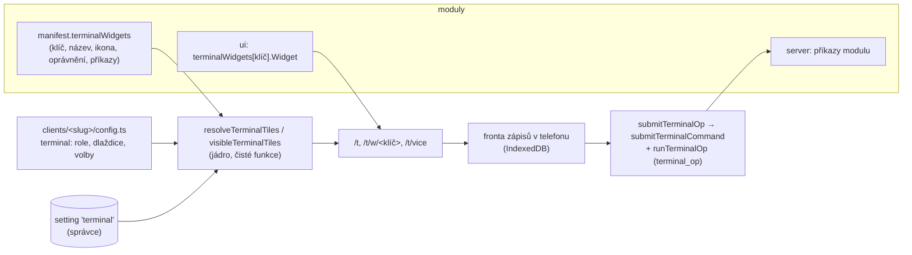

# Mobilní terminál řemeslníka

Samostatné mobilní rozhraní pro lidi na stavbě. Řemeslník (role `worker`) se po přihlášení dostane rovnou do terminálu a do kancelářského
rozhraní nevstoupí; mistr, kancelář a vedení si terminál otevřou jako náhled. Co se v terminálu zobrazí, určují **zapnuté moduly**,
**oprávnění role** a **konfigurace klienta**, kterou správce může v Nastavení upravit. Rozhodnutí a důvody: [ADR 023](adr/023-terminal-remeslnika.md),
otevřené otázky: [OPEN-QUESTIONS](OPEN-QUESTIONS.md) (sekce Terminál).

## 1. Co řemeslník vidí

Úvodní obrazovka `/t` skládá dlaždice pod sebe, dole je lišta s nejvýš pěti položkami (Dnes, až tři dlaždice s vlastní obrazovkou, Více).

| Dlaždice (klíč)                        | Modul     | Co umí                                                                                                             |
| -------------------------------------- | --------- | ------------------------------------------------------------------------------------------------------------------ |
| Docházka (`dochazka.clock`)            | Docházka  | příchod, přestávka, odchod, výběr zakázky, dnešní a týdenní hodiny (bez sazeb a mezd), odeslání týdne ke schválení |
| Dnes na stavbě (`zakazky.today`)       | Zakázky   | zakázky v realizaci: adresa a navigace, kontakt na místě, vedoucí a tým, dnešní práce z harmonogramu               |
| Moje úkoly (`core.tasks`)              | platforma | úkoly přidělené řemeslníkovi, odškrtnutí jedním ťuknutím                                                           |
| Deník (`realizace.diary`)              | Realizace | řádek do dnešního zápisu stavebního deníku a fotky z místa (zápisy kolegů se nepřepisují)                          |
| Materiál (`sklad.issue`)               | Sklad     | rychlý výdej na zakázku: hledání karty, množství, jedno odeslání; naposledy použité karty i bez signálu            |
| Závada a poznámka (`realizace.report`) | Realizace | hlášení závady (založí vadu zakázky) nebo poznámka k dnešku, s fotkou                                              |
| Stroje (`stroje.fleet`)                | Stroje    | zápis dnešního provozu stroje nebo vozidla, hlášení závady stroje                                                  |

Terminál nikdy nevrací ceny, sazby, marže ani ekonomiku zakázky: příkazy dlaždic čtou jen provozní údaje a testy to hlídají
(`tests/terminal.int.test.ts`, `apps/web/e2e-crawl/terminal-obrazovky.crawl.spec.ts`).

## 2. Jak to drží pohromadě



- **Trasy:** `apps/web/src/app/(terminal)/t/` (vlastní layout, ne kancelářský). `/t` úvod, `/t/w/<klíč>` celá obrazovka dlaždice (jen dlaždice s `page: true`),
  `/t/vice` čekající zápisy, instalace na plochu, účet, odhlášení. Dlaždice, kterou uživatel nesmí, je „Stránka nenalezena“.
- **Rám:** `TerminalShell` (`packages/ui/src/terminal/shell.tsx`): úzký sloupec pro jednu ruku, nahoře stav spojení a fronty, dole lišta (každá položka aspoň 64 px).
  Stavební kameny (`BigButton`, `TouchSelect`, `TerminalCard`, `JobPicker`, `PhotoPicker`…) jsou v `packages/ui/src/terminal/kit.tsx` a mají cíle 48 px a víc.
  Pozor: globální pravidlo `pointer: coarse` v `styles.css` nastavuje `min-height: 44px` tlačítkům a přebíjí třídy `min-h-*`; velikost se proto zadává `h-*`.
- **Registr:** jádro (`packages/core/src/terminal/`) nezná konkrétní moduly. Dlaždice přicházejí z manifestů zapnutých modulů (`collectTerminalWidgets`) a z platformy
  (`CORE_TERMINAL_WIDGETS`). `visibleTerminalTiles` je jediné místo, které rozhoduje, co uživatel vidí, a stejnou funkci používá úvodní obrazovka, obrazovka dlaždice
  i přijetí zápisu na serveru (`apps/web/src/server/terminal.ts`).

### Role jen pro terminál a guard

`terminal.roles` (výchozí `["worker"]`) určuje role, které používají jen terminál. Pro ně:

- `/` a každá kancelářská stránka přesměruje na `/t`: `requireCtx` (`apps/web/src/server/request.ts`) to dělá na serveru pro každou stránku a každé rozložení v `(app)`;
  jen stránky vlastního účtu (`/nastaveni/ucet`, `/nastaveni/zabezpeceni`, `/nastaveni/upozorneni`) volají `requireCtx({ allowTerminalOnly: true })` a zobrazí se bez
  kancelářské navigace se zpětným odkazem. Že žádná stránka `(app)` kontrolu nevynechala, hlídá `tests/terminal.test.ts`.
- Oprávnění k datům se tím nemění: server action a příkaz kontrolují oprávnění role jako vždy. Guard omezuje rozhraní, ne data.
- Role nesmí být `owner` (ověřuje schéma konfigurace) ani role, která spravuje systém (`settings.manage`, `users.manage`, `roles.manage`; ověřuje uložení v Nastavení),
  jinak by se správce zamkl mimo Nastavení.
- Ostatní role terminál otevřou z menu („Terminál řemeslníka“) jako náhled s pruhem „Zpět do kanceláře“.

## 3. Konfigurace klienta

Tři úrovně, od výchozí po nejčerstvější:

1. **Typované výchozí hodnoty v `config.ts`** (`terminal` v `clients/<slug>/config.ts`, validace Zodem při startu, `pnpm config:check` ověří i klíče dlaždic proti manifestům):

   ```ts
   terminal: {
     roles: ["worker"],
     tiles: [
       { widget: "dochazka.clock" },
       { widget: "zakazky.today" },
       { widget: "core.tasks", label: "Co mám udělat" },
       { widget: "sklad.issue", enabled: false },
     ],
     attendance: { requireJob: false, allowJobChange: true, showHours: true },
     diary: { requirePhoto: false },
   },
   ```

   Pořadí je pořadí v poli. Dlaždice zapnutých modulů, které tu nejsou, se přidají na konec (podle `defaultEnabled` v manifestu). Klíč dlaždice vypnutého modulu se tiše přeskočí,
   překlep (klíč, který neexistuje v žádném modulu) je chyba při startu.

2. **Nastavení → Terminál řemeslníka** (`settings.manage`): zapnout, přejmenovat a přeřadit dlaždice, vybrat role jen pro terminál, volby docházky a deníku.
   Ukládá se do `setting` (klíč `terminal`, audit). Hodnota shodná s výchozí z `config.ts` se neukládá (`null` = „platí výchozí“), takže pozdější změna konfigurace
   se projeví všude, kde správce nic nepřepsal. „Obnovit výchozí“ vrátí všechno na `config.ts`.
3. **Migrace uloženého nastavení:** nastavení nese `version`. `migrateTerminalSettings` převede starší tvar na aktuální, novější verzi nebo poškozenou položku zahodí a vrátí
   výchozí (terminál kvůli špatnému nastavení nikdy nespadne, Nastavení ukáže, co se zahodilo). Tabulka `terminal_op` (viz níže) má běžnou dopřednou SQL migraci (`0008_terminal_op`).

Volby:

| Volba                       | Význam                                                                                                     |
| --------------------------- | ---------------------------------------------------------------------------------------------------------- |
| `roles`                     | role jen pro terminál (viz výše)                                                                           |
| `tiles[].enabled`, `.label` | zapnutí a přejmenování dlaždice                                                                            |
| `attendance.requireJob`     | příchod nejde zapsat bez zakázky                                                                           |
| `attendance.allowJobChange` | vypnuto: použije se jediná zakázka řemeslníka nebo naposledy použitá, výběr se nabídne jen když není jasná |
| `attendance.showHours`      | dnešní a týdenní hodiny na dlaždici Docházka (jen hodiny; mzda a sazby se nezobrazují nikdy)               |
| `diary.requirePhoto`        | zápis do deníku z terminálu vyžaduje aspoň jednu fotku                                                     |

## 4. Jak přidat dlaždici z modulu

Dlaždice je ve třech částech modulu, jádro se nemění.

1. **Manifest** (`packages/modules/<id>/src/index.ts`): `terminalWidgets: [{ key: "<id>.<název>", label, description, icon, permission, commands, page }]`.
   `key` začíná id modulu, `permission` je oprávnění z katalogu (dlaždici uvidí a použije jen ten, kdo ho má), `commands` jsou **zápisové příkazy**, které smí dlaždice
   posílat přes frontu (musí začínat id modulu), `page: true` dá dlaždici vlastní obrazovku a možnost objevit se ve spodní liště.
2. **Server** (`src/server.ts` modulu): příkazy `defineCommand`. Čtecí příkazy pro terminál nesmí vracet ceny ani sazby; používej vlastní příkaz `<id>.terminal.*`
   (vzor `zakazky.terminal.sites`, `realizace.terminal.today`, `dochazka.terminal.summary`) a zapiš ho do matice oprávnění `tests/support/security-probes.ts`.
   Zápisový příkaz musí být bezpečný při opakování po odložení (kontroluj stav, nepřepisuj cizí data) a smí přijmout `at` (čas ťuknutí, viz fronta).
3. **UI** (`src/ui.tsx` modulu): `defineModuleUi({ terminalWidgets: { "<id>.<název>": { Widget: MojeDlazdice } } })`. `Widget` dostane `label`, `settings`,
   `variant` (`card` na úvodní obrazovce, `page` na celé obrazovce) a `pageHref`. Skládej ho ze stavebních kamenů `@rebar/ui` (`TerminalCard`, `BigButton`, `TouchField`…),
   zápisy posílej přes `useTerminalQueue().submit({ command, input, label, group })` a výsledek ukaž `reportOutcome(out, "Hotovo.")`.
   Soubor se jmenuje `terminal-ui.tsx` (server má `terminal.ts`), `ui.tsx` nesmí importovat serverový kód.

Pak: dlaždici vyzkoušej v Nastavení → Terminál řemeslníka, přidej ji do výchozích dlaždic klienta, jestli má být na začátku, a `pnpm check`. Test `tests/terminal.test.ts`
hlídá, že každá dlaždice z manifestu má UI, existující oprávnění a příkazy se správnou předponou.

Dlaždice platformy (`core.*`, dnes jen úkoly) patří do `CORE_TERMINAL_WIDGETS` v jádru, jejich příkazy do `packages/core/src/terminal/commands.ts` a UI do `apps/web/src/app/(terminal)/t/widget-host.tsx`.

## 5. Zápisová fronta, offline a PWA

- Každý zápis (příchod, odškrtnutí, poznámka…) se **nejdřív uloží do telefonu** (IndexedDB, `packages/ui/src/terminal/queue.ts`) a až pak se odesílá. Nic se neztratí při výpadku
  signálu ani zavření aplikace. Fronta patří přihlášenému uživateli: na sdíleném telefonu se zápisy jednoho člověka nikdy neodešlou pod účtem jiného.
- **Idempotence:** zápis nese `opId` (UUID). Server (`runTerminalOp`, tabulka `terminal_op`) ho zapíše ve stejné transakci jako vlastní zápis; opakované odeslání
  (ztracená odpověď, dvojí ťuknutí, dvě otevřené záložky) vrátí původní výsledek a nic nezduplikuje. Souběžné odeslání téhož `opId` počká na první transakci.
  Selže-li zápis, řádek se nezapíše a jde ho zkusit znovu. Staré řádky se po 60 dnech uklidí.
- **Čas:** vstup dostane čas ťuknutí `at`; příkaz ho použije (docházka: příchod a odchod s přesným časem, nejdéle 72 hodin zpětně, deník 14 dní), takže zápis odložený
  bez signálu nepřijde s časem doručení.
- **Dočasné chyby** (bez spojení, chyba serveru) se opakují s rostoucími odstupy (2 s až 30 min) a po návratu spojení hned. Zápisy téže skupiny (`group`) se odesílají
  v pořadí; chyba jednoho nezablokuje ostatní skupiny.
- **Konflikt** (server zápis trvale odmítl: „Píchačka už běží“, podepsaný zápis deníku, nedostatek zboží, chybějící oprávnění) označí zápis jako konflikt s českou větou.
  Zůstane v telefonu (Více → Čekající zápisy), dokud ho člověk nezkusí znovu nebo výslovně nezahodí. Hlavička ukazuje „Čeká na odeslání: N“ a „Konflikt: N“.
- **Zápis přes server:** `submitTerminalOp` (`apps/web/src/server/terminal-actions.ts`) přijme jen příkaz, který deklaruje **viditelná** dlaždice uživatele
  (`terminalCommandAllowed`); dlaždice vypnutého modulu, bez oprávnění nebo vypnutá správcem je pro server neexistující. Pak platí oprávnění příkazu a validace vstupu.
- **Fotky** jdou stávající frontou nahrávání (`packages/ui/src/data/upload-queue.ts`) a připojí se k zakázce jako fotky z místa.
- **PWA:** terminál má vlastní manifest `/t/manifest.webmanifest` (`start_url: /t`, ikony `/pwa-icon/*`), Více → Aplikace na ploše nabídne instalaci (na iPhonu postup přes Sdílet).
  Service worker (`apps/web/public/sw.js`, oddělený blok pod push částí) při otevření terminálu bez spojení ukáže stránku `t-offline.html`; nekešuje žádná data uživatele.
  Terminál, který je už otevřený, běží bez signálu dál (data z poslední načtené obrazovky, zápisy do fronty); „studený start“ bez signálu zobrazí jen stránku Jste offline.

## 6. Testy

| Test                                                    | Co hlídá                                                                                                                         |
| ------------------------------------------------------- | -------------------------------------------------------------------------------------------------------------------------------- |
| `packages/core/src/terminal/terminal.test.ts`           | registr, pořadí, filtrování podle modulů a oprávnění, konfigurace (zod), migrace nastavení, kontrola sestavy                     |
| `packages/ui/src/terminal/queue.test.ts`                | fronta: žádná tichá ztráta, opakování, konflikt, pořadí ve skupině, sdílený telefon                                              |
| `tests/terminal.test.ts`                                | dlaždice a UI modulů, příkazy a oprávnění, výchozí konfigurace klientů, každá kancelářská stránka je pod guardem                 |
| `tests/terminal.int.test.ts`                            | idempotence zápisů (i souběžně), odmítnutí příkazu mimo dlaždice, `at`, konflikty, úkoly, deník, zakázky bez cen, nastavení v DB |
| `tests/security-matrix.int.test.ts`                     | příkazy `*.terminal.*` a `core.tasks.*` v matici rolí (montér a mistr nevidí peníze ani cizí zakázky)                            |
| `apps/web/e2e-crawl/terminal-obrazovky.crawl.spec.ts`   | telefon 375 × 812: bez chyb v konzoli, bez přetoku, cíle aspoň 44 px, bez tabulek, nejvýš pět položek lišty, bez cen             |
| `apps/web/e2e-crawl/terminal-pristup.crawl.spec.ts`     | guard (worker nesmí do kanceláře), náhled pro mistra, vypnutí a přejmenování dlaždice v Nastavení                                |
| `apps/web/e2e-crawl/terminal-denni-prace.crawl.spec.ts` | příchod → úkol → odchod, práce bez signálu, ztracená odpověď serveru, konflikt z druhého zařízení                                |
| `apps/web/e2e-crawl/pristupnost.crawl.spec.ts`          | axe (WCAG 2 A a AA) obrazovek terminálu, světlý a tmavý režim                                                                    |

Spuštění: `pnpm test:crawl terminal` (procházecí testy, vlastní výstup `CRAWL_OUTPUT_DIR=test-results-crawl-terminal`), integrační testy
`REBAR_TEST_DB_NAME=rebar_test_terminal pnpm exec vitest run tests/terminal.int.test.ts`.

## 7. Omezení

- Hledání materiálu a výběr zakázky potřebují signál; bez něj se nabízí naposledy načtené zakázky a naposledy vydané karty. Zápis výdeje bez signálu se ale uloží a odešle.
- Fotky z deníku se připojí k zakázce (Soubory), do polí „fotky dne“ deníku je přiřazuje kancelář.
- Fronta nahrávání fotek je sdílená mezi uživateli telefonu (starší chování, nejde o frontu zápisů).
